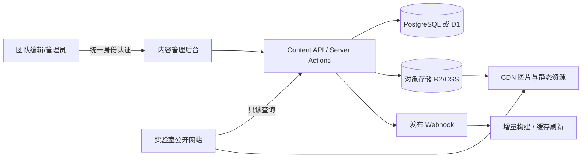
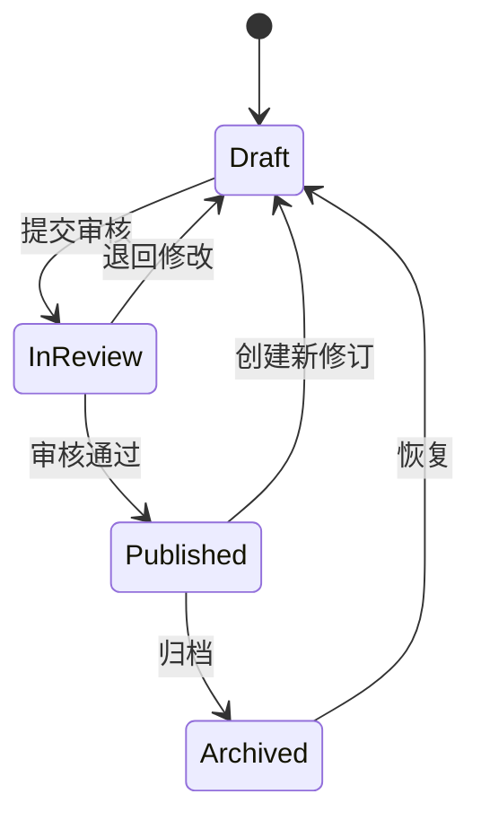

# 课堂智能与教育技术实验室网站｜后端与内容平台设计

## 1. 目标与边界

后端的核心职责是安全地维护人员、新闻、论文、项目、研究方向、相册和网站设置，并为前端提供稳定的只读内容接口。行为识别 Demo 在展示站中使用脱敏演示数据，不直接接入真实课堂视频；若未来接入研究系统，应作为独立受控平台建设，不能与公开官网共用数据域。

首版 UI 原型不依赖数据库即可运行。生产环境建议使用“内容管理后台 + 内容 API + 对象存储”的轻量架构。

## 2. 推荐架构



小规模低维护方案：Cloudflare D1 + R2 + Worker；学校已有统一平台时，可替换为 PostgreSQL + 校内对象存储。业务模型保持不变。

## 3. 权限模型

| 角色 | 权限 |
| --- | --- |
| Viewer | 访问公开内容 |
| Editor | 创建/编辑草稿、上传图片、提交审核 |
| Reviewer | 审核并发布新闻、成果和人员变更 |
| Admin | 用户与角色管理、站点设置、归档与恢复 |

所有写操作要求登录、CSRF 防护和审计日志。涉及学生信息时遵循“最小公开”原则：个人邮箱、手机号、未经授权的照片和去向信息默认不公开。

## 4. 数据模型

### Member

`id, slug, name_zh, name_en, category(advisor|researcher|student|alumni), title, degree, bio, interests[], photo_asset_id, homepage_url, email_public, cohort, destination, display_order, status(draft|published|archived), created_at, updated_at`

### News

`id, slug, title, summary, body_richtext, category, cover_asset_id, gallery_asset_ids[], happened_at, published_at, author_id, status`

### Publication

`id, title, authors_text, venue, year, doi, external_url, abstract, tags[], featured, display_order, status`

### Project

`id, title, level, grant_number, principal_investigator, start_date, end_date, summary, related_direction_ids[], cover_asset_id, status`

### ResearchDirection

`id, slug, title, summary, body_richtext, architecture_asset_id, metrics_json, demo_config_json, display_order, status`

### Activity / Gallery

`id, title, activity_date, description, asset_ids[], cover_asset_id, featured, status`

### Asset

`id, object_key, original_filename, mime_type, width, height, bytes, alt_text, credit, consent_record, focal_point_json, created_by, created_at`

### SiteSetting

`key, value_json, updated_at`，用于实验室名称、地址、联系邮箱、页脚文本和首页精选内容。

## 5. API 设计

公开 API 使用版本前缀 `/api/v1`，只返回已发布内容。

| 方法 | 路径 | 说明 |
| --- | --- | --- |
| `GET` | `/api/v1/home` | 首页聚合：精选照片、最新新闻、研究方向 |
| `GET` | `/api/v1/members?category=student` | 按成员类型查询 |
| `GET` | `/api/v1/members/:slug` | 成员详情 |
| `GET` | `/api/v1/news?page=1&pageSize=10` | 新闻列表 |
| `GET` | `/api/v1/news/:slug` | 新闻详情 |
| `GET` | `/api/v1/publications?year=2026&tag=` | 论文筛选 |
| `GET` | `/api/v1/projects?status=active` | 项目列表 |
| `GET` | `/api/v1/research-directions` | 研究方向与展示配置 |
| `GET` | `/api/v1/activities` | 文化活动与相册 |

管理端采用 `/api/admin/v1/*`，提供 CRUD、草稿、预览、审核、发布和排序接口。写操作使用乐观锁字段 `updated_at/version`，避免多人编辑覆盖。

示例响应：

```json
{
  "data": [],
  "meta": { "page": 1, "pageSize": 10, "total": 0 },
  "requestId": "req_xxx"
}
```

错误响应统一为：

```json
{
  "error": { "code": "VALIDATION_ERROR", "message": "字段校验失败", "fields": {} },
  "requestId": "req_xxx"
}
```

## 6. 内容工作流



图片上传后必须填写替代文本；人物照片需勾选“已获得公开展示授权”。论文可通过 DOI 拉取元数据，但发布前必须人工确认作者、期刊和年份。

## 7. 缓存与发布

- 首页聚合缓存 5 分钟，新闻/成员/成果详情缓存 30 分钟。
- 内容发布后触发 Webhook，按路径失效缓存或执行 ISR revalidate。
- 图片使用内容哈希文件名和长期缓存；替换图片生成新 URL，避免 CDN 脏缓存。
- 数据库每日备份；对象存储开启版本管理；保留 180 天审计日志。

## 8. 安全与合规

- 公开站与真实课堂数据平台物理/逻辑隔离；公开站永不持有原始课堂音视频和学生行为数据。
- 上传文件校验 MIME、扩展名、大小和图像解码结果，拒绝 SVG 脚本及可执行内容。
- 管理端启用 MFA 或学校统一身份认证；敏感操作二次确认。
- 输出富文本前执行白名单清洗；API 限流；安全响应头包含 CSP、HSTS、`X-Content-Type-Options`。
- 成员离组时执行权限回收；人物信息支持撤回授权和快速下线。

## 9. 运维与可观测性

- 结构化日志字段：`requestId, route, status, latencyMs, actorId, action`。
- 监控：5xx 比例、P95 响应时间、图片处理失败、发布 Webhook 失败、数据库容量。
- 发布策略：开发 / 预发布 / 生产三环境；数据库迁移先在预发布验证；前端与内容模型按版本兼容。

## 10. 实施阶段

1. **内容上线**：完成数据模型、管理登录、成员/新闻/论文/项目 CRUD、图片上传。
2. **流程完善**：审核发布、版本历史、预览链接、缓存刷新、审计日志。
3. **研究联动**：仅接入经过脱敏和聚合的系统指标；不接入原始课堂数据。
4. **持续运营**：DOI 导入、年度成果导出、双语内容、多成员协作与统计分析。
