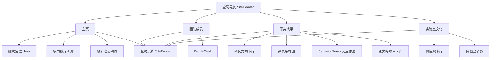

# 课堂智能与教育技术实验室网站｜前端与体验设计

## 1. 产品定位

网站服务三类核心访客：希望了解团队方向的学术同行、寻找导师与课题的学生、关注合作可能的学校及行业伙伴。首要任务不是“宣传口号”，而是让访客在 30 秒内完成三件事：理解实验室研究什么、快速浏览人员与成果、感受到团队可信而有温度的文化。

当前版本是可运行的高保真 UI 原型。团队姓名、照片、论文、项目和指标均明确使用示例内容，避免将虚构信息当成真实成果。正式发布前应通过内容后台替换。

## 2. 信息架构

| 路由 | 页面目标 | 主要内容 |
| --- | --- | --- |
| `/` | 建立第一印象，导向最新内容 | 实验室定位、研究现场图、研究方向、横向照片画廊、最新动态 |
| `/people` | 展示团队结构和个人信息 | 顾问、研究人员、在读学生、毕业学生；照片、简介、标签、个人主页入口 |
| `/research` | 以“方向—系统—证据—成果”讲清科研能力 | 研究方向卡片、架构图、交互式行为识别 Demo、系统指标、论文、项目 |
| `/culture` | 传达实验室共同体与长期愿景 | 价值观、活动节奏、课外活动影像、实验室愿景 |

## 3. 视觉系统

- 视觉命题：**理性的课堂蓝图，带一点实时信号的锋利感**。
- 主色：深海军蓝 `#081B32`，表达学术可靠性；高饱和蓝 `#1459FF` 作为信息焦点；青色 `#21D4D1` 表示数据与实时信号。
- 字体：中文系统无衬线用于正文；宋体用于关键宣言，形成“技术 × 人文”的对比。
- 图形语言：细边框、低圆角、编号系统、信号线和模块化栅格。避免通用企业模板式大圆角与渐变卡片堆叠。
- 图片：首版使用两张 AI 生成示例图，并在界面显著标注；正式版必须换成团队有使用权的实拍图。

## 4. 页面与组件设计

共享组件：

- `SiteHeader`：桌面导航、移动端折叠菜单、当前页状态。
- `SiteFooter`：版权、核心导航与研究关键词。
- `ProfileCard`：成员照片区、角色、简介、研究标签和个人主页入口。
- `BehaviorDemo`：使用客户端状态切换“专注度 / 举手行为 / 互动讨论”三个演示指标。

## 5. 关键交互

1. 主页近期影像采用横向滚动与 `scroll-snap`，移动端单卡接近满宽，提示可继续滑动。
2. 研究页面 Demo 允许切换分析指标，环形图和解释文案同步变化；所有数值均标注为演示数据。
3. 卡片悬停只使用轻微位移、边框与阴影变化，不干扰阅读。
4. 移动端导航使用原生 `details/summary`，无需额外脚本即可键盘操作。

## 6. 响应式策略

- `>1000px`：完整三栏、四栏学术展示布局。
- `661–1000px`：人物与指标降为双栏；系统图允许换行；交互 Demo 改为上下结构。
- `≤660px`：所有核心内容单栏；照片画廊保留横向滑动；表格式校友信息转为纵向卡片。
- 主正文默认不低于 14px，常规阅读文字 16px 左右；支持浏览器 200% 文字放大，不依赖固定高度承载正文。

## 7. 可访问性与性能

- 页面使用语义化 `header / nav / main / section / article / footer`；图片包含用途明确的中文替代文本。
- 交互按钮具备原生键盘与焦点能力；指标切换使用 `role="group"` 和可读标签。
- 使用 Next Image 输出响应式图片；正式版建议将团队照片转为 AVIF/WebP，并保留原始照片授权记录。
- 目标：LCP < 2.5s、CLS < 0.1、移动端 Lighthouse Accessibility ≥ 95。

## 8. 内容替换清单

正式上线前需要补齐：实验室正式中英文名、团队 Logo、成员姓名与照片、个人主页 URL、论文 DOI/链接、项目名称与编号、真实系统指标、新闻日期与详情链接、真实活动照片、联系地址与邮箱、版权与隐私说明。

## 9. 前端技术方案

- Next.js/Vinext + React 19 + TypeScript。
- CSS Token 维护品牌色与版式；Lucide 图标；不依赖重型动效库。
- 当前内容写在页面数据数组中，便于首版评审；生产版由后端 CMS API 提供并在构建/请求时渲染。
- 推荐采用 ISR 或按内容更新时间触发增量构建，使新闻和成果更新不需要修改代码。
