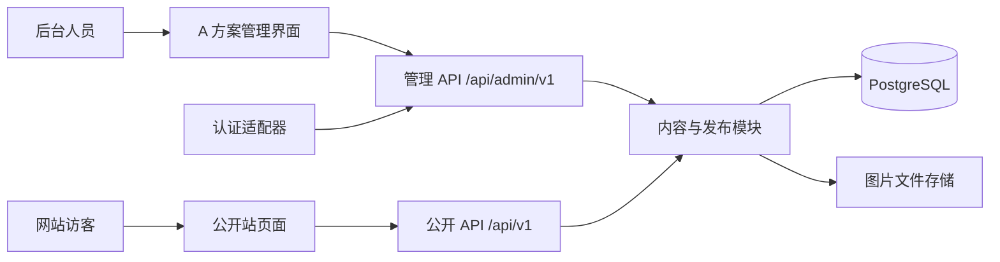

# 网站与内容平台实施设计

更新日期：2026-10-13。状态：总体实施基线。本文汇总已经确认的决定；正式目录、完整接口契约、逐模块交付和进度证据以[后端与前后端联调具体实现方案](后端与前后端联调具体实现方案_20261013.md)及[进度跟踪](../进度文档/后端与前后端联调进度跟踪_20261013.md)为准。内容类型的表单字段仍需随各模块实现逐项核对。

## 1. 已确认范围与当前代码

| 事项 | 当前决定或事实 |
| --- | --- |
| 后台界面 | 采用 A「侧栏工作台」的整体风格、布局和模块入口；原型在 `frontend/admin-prototype.html?variant=A` |
| 首版模块 | 成员、新闻、论文、项目、研究方向、活动相册、媒体库、站点设置、操作记录和账号管理 |
| 人员权限 | 不超过 5 位获准人员；所有人可编辑、核验、发布和撤回；管理员另可管理账号；所有操作留痕 |
| 数据库 | 本地与未来云服务器均使用 PostgreSQL |
| 语言 | 中文优先，英文可并行录入；英文未核查时不公开，不阻断中文发布 |
| 部署 | 当前本地开发，后续部署云服务器；云服务商、存储、域名和认证入口尚待定 |
| 公开站视觉 | 以 `visual-preview-20261013` 的学术编辑式设计作为实现基线，开发过程中可微调；原版暂存供对照 |

当前四个静态页面由 `frontend/assets/js/data.js` 提供数据；Express 的公开 API 从 `frontend/server/data/content.json` 读取另一份数据，只提供 GET，`/api/admin/v1` 仍是未授权占位。**实现目标是消除两份内容源，公开页和 API 都读取 PostgreSQL 中的已发布版本。**

## 2. 系统边界

开发初期继续使用现有 Express 和静态 HTML，先由同一服务在本地提供页面及 `/api`，避免静态服务器与 API 端口分离造成不必要的跨域配置。视觉副本仍可由 8080 静态服务独立预览。将来是否升级前端框架应由编辑复杂度决定，不作为数据库和 API 开发前提。

## 3. 后台功能与按模块编辑内容

共同流程：列表检索与筛选 → 新建或编辑草稿 → 来源与授权检查 → 中文／英文预览 → 发布或撤回 → 查看修订与操作记录。编辑已发布内容时产生新修订，官网继续展示上一次已发布版本。

| 模块 | 首轮编辑区重点 | 发布检查重点 |
| --- | --- | --- |
| 成员 | 姓名、身份分类、导师／学生／校友信息、研究兴趣、简介、个人链接、照片、排序；照片／简介／邮箱／去向分别控制公开 | 身份与个人字段授权、照片授权、有效主页 |
| 新闻 | 标题、摘要、正文、分类、事件日期、封面、关联活动或成果 | 事件日期、事实来源、图片与对外链接 |
| 论文 | 题名、作者顺序、刊物或会议、年份、发表阶段、DOI／出版链接、研究方向关联、精选标记 | 出版来源、年份与发表阶段一致、DOI 去重；未来年份不可自动标已发表 |
| 项目 | 正式名称、编号、资助类别、负责人、起止日期、项目进度、介绍、关联成果 | 项目名称与编号来源、起止日期、在研／结题状态 |
| 研究方向 | 中英文标题、简介、子主题、排序、相关项目与论文 | 对外方向口径已确认、关联对象可公开 |
| 活动相册 | **以照片管理为主**：批量选图、顺序、封面、逐图说明／替代文本；另填活动名称、日期和简述 | 图片版权、人物展示授权、每张图的说明与停用状态 |
| 媒体库 | 上传、预览、来源、版权／人物授权、引用位置、替换与停用 | 文件类型和大小、可公开许可、被引用情况 |
| 站点设置 | 名称与 Logo、简介、联系邮箱、首页精选、统计数字及口径 | 基础信息来源、联系人确认、Logo 和图片授权 |
| 操作记录／账号 | 按内容／人员／时间查询记录；管理员启停人员并设置角色 | 不允许普通内容人员管理账号；账号停用立即生效 |

以上是**编辑能力清单**，不是统一表单模板。先建设共同外壳与发布流程，再按模块做专用界面；尤其活动相册需图片排序与多图核验，论文需结构化引用信息。每个模块完成时要用真实内容样本确认字段、必填项和操作顺序。

## 4. PostgreSQL 数据库结构

详细逻辑表见[数据库结构与发布状态设计](数据库结构与发布状态设计_20261013.md)。首版迁移按以下分组落地；主键建议 UUID，所有时间存带时区时间，公开 API 输出 ISO 8601 时间。

| 分组 | 表 | 关键关系与职责 |
| --- | --- | --- |
| 身份 | `admin_users`、`admin_identities` | 人员与登录身份分离；同一人未来可绑定专用账号或学校统一身份；仅管理员可管理用户 |
| 内容基础 | `content_items`、`content_revisions`、`content_localizations`、`content_publications` | 内容稳定 ID、不可变修订、按语言文案、按语言公开指针；公开查询只读公开指针 |
| 类型详情 | `member_revisions`、`news_revisions`、`publication_revisions`、`project_revisions`、`direction_revisions`、`activity_revisions` | 每条详情依附一次修订，避免新草稿覆盖官网内容 |
| 关联与来源 | `content_relations`、`content_sources`、`member_permissions` | 内容之间的关联、事实来源与成员字段级授权；内部凭据不出公开 API |
| 图片 | `assets`、`content_assets`、`asset_clearances` | 图片元数据、修订中的图片顺序／封面关系、版权与人物授权记录；文件本体不入数据库 |
| 设置与审计 | `site_settings`、`site_setting_revisions`、`audit_events` | 设置也分草稿与公开版本；写入、发布、撤回和账号操作留痕 |

`asset_clearances` 是在原逻辑模型上补充的媒体授权表，至少记录 `asset_id`、`clearance_type`（版权或人物展示）、`subject_ref`、`allowed`、`evidence_ref`、`checked_by`、`checked_at`、`withdrawn_at`。活动照片可涉及多人；缺少必要许可或许可被撤回时，公开接口立即停止输出对应图片。若一张图因撤回不能再使用，媒体库还需显示其被哪些已发布页面引用。

核心约束：`content_items(type, slug)` 唯一；`content_revisions(content_id, version)` 唯一；`content_publications(content_id, locale)` 唯一；公开指向的修订必须属于同一内容；站点设置指针必须属于同一设置键；项目结束日期不能早于开始日期；图片引用与内容修订使用外键。发表阶段、项目进度和内容发布状态使用不同字段。DOI／项目编号跨内容查重可在发布检查中实现，历史修订允许保存相同值。

发布事务：检查目标修订与语言 → 校验必填项、来源及授权 → 更新该语言的公开指针 → 写入发布人和时间 → 写入 `audit_events`。英文发布前要求中文已存在公开版本；共享事实变化时重新检查旧英文版本。撤回事务移除公开指针并记录原因；不删除历史修订。并发编辑使用版本号检测冲突。

## 5. 数据来源与迁移规则

| 来源 | 当前用途 | 导入方式 |
| --- | --- | --- |
| `frontend/assets/js/data.js` | 现有公开页面内容与部分占位、演示数据 | 逐字段导出为待核验导入清单，不直接标记已发布 |
| `frontend/server/data/content.json` | 现有只读 API 内容 | 与前端清单按类型、名称、slug 对照，保留冲突记录，不覆盖较新的事实 |
| 用户提供的[王志锋教师主页](https://faculty.ccnu.edu.cn/wangzhifeng/zh_CN/index.htm) | 负责人信息、部分成果与项目的初始公开来源 | 保存来源 URL、核验日期与所支持的具体字段；不等同于本站取得照片及个人信息再展示授权 |
| 实验室负责人／成员提供的材料 | 成员、新闻、活动、联系方式及校友去向 | 由获准人员在后台录入，保存核查人与授权证据引用 |
| 出版方或 DOI 页面、项目正式材料 | 论文发表阶段、DOI、项目状态 | 与教师主页交叉核对后发布；链接与核查日期入 `content_sources` |
| 学校官网 | 学校身份、公开活动及新闻的辅助参考 | 只引用相关原始事实，不把学校首页的新闻或图片自动同步进实验室网站 |

导入过程产生 `import_candidates` 清单或一次性导入报告，至少记录原文件、原记录 ID、目标类型、差异、来源、核验状态和处理人。所有 `@@@`、未确定研究方向、缺授权照片、未来年份论文及可能过期的项目状态均保持草稿或暂不导入公开表。研究方向当前前端为 3 类、后端 JSON 为 4 类，按 D02 待负责人确认后统一。首发时只发布逐条核查完成的内容；不能为了填满版面发布示例数据。

## 6. API 与页面联调契约

### 管理 API

首版统一在 `/api/admin/v1` 下，全部要求有效登录会话。建议资源形态：

| 操作 | 路径示例 | 关键输入或输出 |
| --- | --- | --- |
| 当前账号与权限 | `GET /me` | 用户 ID、角色和可操作范围 |
| 内容列表／详情 | `GET /contents?type=publication&status=draft&page=1`、`GET /contents/:id` | 分页、筛选、当前草稿与各语言公开状态 |
| 新建／保存修订 | `POST /contents`、`PUT /contents/:id/draft` | 类型专用字段、语言、期望版本号；冲突返回 409 |
| 预览／发布前检查 | `GET /contents/:id/preview?locale=zh`、`POST /contents/:id/check` | 预览数据与字段级错误／警告，不改变公开版本 |
| 发布／撤回 | `POST /contents/:id/publish`、`POST /contents/:id/withdraw` | 语言、修订 ID、版本号、操作原因；返回新公开状态 |
| 历史与来源 | `GET /contents/:id/revisions`、`GET/PUT /contents/:id/sources` | 修订、核查人与来源信息 |
| 媒体 | `POST /assets`、`GET /assets`、`PUT /assets/:id` | 文件元数据、授权、引用位置和停用状态 |
| 设置、记录、账号 | `/settings`、`/audit-events`、`/users` | 设置草稿／发布、只读审计；账号写操作仅管理员 |

响应保持现有 `{data, meta, requestId}` 风格；失败统一 `{error:{code,message,fields},requestId}`。列表明确排序与最大分页大小。管理员权限、文件上传格式、会话失效、输入校验、版本冲突和发布前检查均由服务端执行，前端显示服务端结果。

### 公开 API 与静态页面

保留现有 `/api/v1/home`、`/members`、`/news`、`/publications`、`/projects`、`/research-directions`、`/activities` 等资源路径；逐个接口改为只查询对应语言已发布修订。详情未发布时返回 404，列表为空时返回空数组，首页隐藏无内容栏目。`/home` 聚合站点设置、精选方向、新闻和相册；人物私人字段、核查材料、内部 ID 和草稿不得出现在公开响应中。

前端先建立统一的 `api` 读取层，再替换 `window.LAB` 的页面数据来源。加载失败显示可理解的错误或空状态，**不回退到旧 `data.js` 中未经核验的内容**。先接入已确认的视觉优化副本；原版暂保留供对照，待新站完成联调后再收敛为一套公开页面。中文和英文请求带明确 `locale`，未经审核的英文条目不混入中文文案。

## 7. 实施与验收顺序

1. **内容差异清单**：对照两份 JSON、设计文档和来源材料，确认研究方向、首页统计及首批可发布内容；建立待核验／授权清单。
2. **数据库迁移**：先建身份、内容、修订和发布表，再建类型详情、媒体、来源与审计表；提供可重复运行的空库迁移和仅用于开发的示例种子。
3. **后台基础**：用已确认的 A 布局实现登录保护、模块列表、共同草稿／预览／发布外壳和操作记录；逐模块实现专用表单。活动相册与论文优先以真实使用样本验证交互。
4. **公开 API**：从 PostgreSQL 读取已发布修订；先接首页、研究方向和新闻，再接成员、论文、项目、活动及站点设置；每接一类就删除对应静态数据依赖。
5. **前端联调**：核对 API 字段与页面显示；以优化版完成桌面与手机布局验收，原版只作对照。
6. **端到端验收**：同一人创建草稿、核验、预览、发布，公开页同步显示；再次编辑不改变旧公开版；撤回后页面和 API 同时下线；中文可独立发布；英文未核查不出现；停用照片或撤回授权立即生效；普通账号不能管理人员。
7. **云端准备**：确定认证方式、云服务器与图片存储、域名、HTTPS、备份恢复责任和内容下线联系人，完成本地到云端迁移演练后再公开发布。

每个阶段以可演示的页面、接口返回和验收记录为完成条件。只做表结构或只让静态页面打开，都不算完成前后端联调。

## 8. 仍需确认的外部事项

- 研究方向最终名称与排序、首批成员和成果的公开范围，以及内容事实的最终负责人。
- 专用账号或学校统一身份认证的最终登录入口；本地开发可先实现专用账号适配器，保留身份绑定结构。
- 云服务器、图片存储、域名、备份恢复与运维负责人。
- 优化副本在正式接入真实内容时的局部样式细节。

这些事项不妨碍先做数据库迁移、后台共同外壳和公开 API 契约；涉及真实内容发布和云端开放的步骤必须等相应信息确认。
